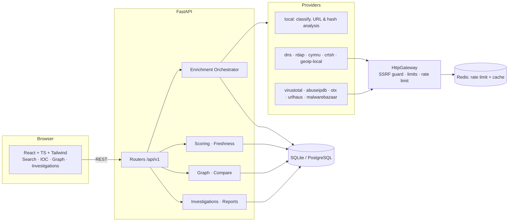

# HunterIntel — Architecture & Implementation Plan

HunterIntel is a modular OSINT / Cyber Threat Intelligence platform for SOC analysts,
incident responders and researchers. It aggregates public and optional third-party
sources, normalises the output into a single evidence model, scores it in an
explainable way, and lets analysts organise the result into investigations.

> **Name.** The brief used both *HUNTERINTEL* and *MONKEINTEL*. The code uses
> **HunterIntel** (package `hunterintel`, env prefix `HUNTERINTEL_`). The display name
> lives in one place per tier (`Settings.app_name`, `frontend/src/brand.ts`) if you want to rename it.

## 1. Design principles

| Principle | What it means in the code |
|---|---|
| **Honest evidence** | Every datum carries an *assurance level* — `verified`, `provider_claim`, `inferred` — and anything we could not obtain is reported as an explicit *provider run status* (`not_configured`, `no_data`, `blocked`, `rate_limited`, `timeout`, `error`). Nothing is fabricated; "no result" is never rendered as "clean". |
| **Works with zero keys** | DNS, RDAP (IANA bootstrap), Team Cymru IP→ASN (over DNS), crt.sh and local analysis need no credentials. Keyed providers light up when their env var is set. |
| **No silent sharing** | Indicators leave the host only when an analyst explicitly runs an enrichment with a visible *query plan*. Providers are tiered (`local` / `public` / `third_party`); only tiers ≤ `HUNTERINTEL_DEFAULT_SHARING` are pre-selected. Indicators flagged `do_not_share`, private/internal indicators, and e-mail local-parts never go to third parties. **No code path uploads file content anywhere.** |
| **One egress point** | All outbound HTTP goes through `core/http.py` (`HttpGateway`): TLS verification, timeouts, response-size cap, per-provider rate limits, host allow-list, and a connect-time SSRF guard that pins the validated IP. |
| **Provider = adapter** | A provider is one class implementing `Provider.lookup()`. Adding a source never touches the orchestrator, scoring, DB or UI. |

## 2. Component view



### Backend packages (`backend/hunterintel`)

| Package | Responsibility |
|---|---|
| `config.py` | Typed settings from env (`pydantic-settings`). Secrets are `SecretStr`; never serialised. |
| `core/netpolicy.py` | Classifies IPs/hostnames as public vs private/loopback/link-local/CGNAT/multicast/reserved/documentation; unwraps IPv4-mapped, 6to4, NAT64 and Teredo addresses. |
| `core/http.py` | `HttpGateway` + `GuardedBackend` (httpcore network backend that resolves, validates and **pins** the destination IP at connect time — defeats DNS-rebinding), manual redirect following with per-hop validation. |
| `core/ratelimit.py`, `core/cache.py` | Rate limiter and TTL cache with in-memory and Redis implementations behind one interface. |
| `core/redact.py` | Secret redaction for any string that might reach logs, errors or API responses. |
| `domain/` | Indicator types, parsing/normalisation/classification, assurance & result models (pure, no I/O). |
| `db/` | SQLAlchemy 2.0 async models, session management. Alembic migrations live in `backend/alembic`. |
| `providers/` | `Provider` ABC, registry, and one module per source. |
| `services/` | Orchestrator, IOC store, scoring, graph, compare, investigations, report export, file tools. |
| `api/` | FastAPI routers, dependency wiring, optional bearer-token auth. |

## 3. Evidence model

```
Indicator ──< Observation          (what a provider said / we observed; history preserved)
Indicator ──< ProviderRun          (what we asked, and the outcome — incl. failures)
Indicator ──< IndicatorTag         (tag + source attribution)
Indicator ──< Relationship >── Indicator   (typed, directed, assurance-labelled edges)
Investigation ──< InvestigationIndicator >── Indicator
Investigation ──< Finding / Note
```

* **Assurance**
  * `verified` — observed first-hand from the authoritative source of record (DNS answers, registry RDAP) or computed locally (parsing, hashing).
  * `provider_claim` — asserted by a third-party service (VirusTotal, crt.sh, Team Cymru, a GeoIP database…). Reported with attribution, not independently confirmed.
  * `inferred` — derived by HunterIntel from other data (shared infrastructure, heuristics). The derivation (`basis`) is stored with it.
  * *unavailable* — not an observation at all but a `ProviderRun` row with a status and reason.
* **History.** Re-enriching never overwrites. Observations are fingerprinted; an identical observation only bumps `last_seen`/`seen_count`, a changed one is a new row. The UI shows this as a timeline (e.g. DNS changes).
* **Discovered vs tracked.** Indicators found via relationships (e.g. 40 SAN names on a certificate) are stored as `tracked=false` so they appear in the graph but do not pollute the IOC list until an analyst adopts them.

## 4. Threat-intelligence logic

* **Source attribution & first/last seen** on every indicator, observation, tag and edge.
* **Freshness / expiry.** Each type has a TTL (`ip` 30 d, `url` 30 d, `domain` 90 d, `hash` 365 d, …). `freshness = fresh | aging | stale | expired` from `age / ttl`; expired IOCs are hidden from default lists and contribute no confidence.
* **Scoring (explainable).** Reputation providers emit normalised *signals* `{strength 0‒1, malicious?, reliability}`.
  * `risk_score = 100 · (1 − Π(1 − strength·reliability))` over malicious-leaning signals (noisy-OR). Local heuristics (young domain, obfuscated URL host…) are capped contributors and labelled `inferred`.
  * `confidence = 100 · (1 − Π(1 − reliability))` over *independent sources that returned a definitive signal*, × a freshness factor, minus a conflict penalty when sources disagree.
  * **No signals ⇒ verdict `unknown`**, never `clean`. A breakdown list of every contribution is returned with the score.
* **Analyst classification** (`unclassified | benign | suspicious | malicious | false_positive`) and free tags are stored separately from the computed verdict; both are displayed.

## 5. Security model

| Threat | Control |
|---|---|
| SSRF via URL redirect analysis | Opt-in (`ALLOW_ACTIVE_PROBES`); http/https only; port allow-list; no userinfo; each redirect hop re-validated; destination hostname resolved and **all** addresses must be public; connection pinned to the validated IP (SNI/cert still checked against the hostname); no cookies/auth forwarded; body never read; max hops. |
| SSRF via provider calls | Providers declare `allowed_hosts`; the gateway refuses anything else and refuses non-HTTPS. Same connect-time IP guard. |
| Private-range lookups | Private/loopback/link-local/internal indicators are classified locally and every remote provider is `blocked` with a reason. |
| Resource exhaustion | Per-request timeout, streamed reads with hard byte cap, bounded fan-out (max SAN domains, max certs, max graph nodes), upload size cap on the local file tool. |
| Secret exposure | Keys only from env, `SecretStr`, sent only in headers, redacted from errors; `/providers` reports `configured: true/false` only. |
| Outbound abuse / ToS | Per-provider token-bucket limits (defaults follow each vendor's free-tier guidance), global cap, response cache to avoid duplicate queries. |
| Unauthorised API use | Optional `HUNTERINTEL_API_TOKEN` bearer auth (constant-time compare), inbound rate limit, strict CORS. |
| Injection / XSS | SQLAlchemy parameters only; HTML report rendered with auto-escaping Jinja2; the SPA never uses `dangerouslySetInnerHTML`; Markdown notes rendered as text. |
| Active scanning | None. No port scans, no crawling, no authentication, no scraping of private resources. The only active actions are the two opt-in probes above, each a single bounded request. |

## 6. Provider matrix

| Provider | Key | Tier | Indicator types | Notes |
|---|---|---|---|---|
| `local` | – | local | all | Parsing, normalisation, URL component & heuristic analysis, hash recognition, IP scope. |
| `dns` | – | public | domain, ip, email(domain) | A/AAAA/MX/TXT/NS/CNAME/SOA/CAA, SPF/DMARC, PTR + forward-confirmed rDNS. Resolvers configurable (default public resolvers). |
| `rdap` | – | public | domain, ip, asn | IANA bootstrap → authoritative RDAP server. Registration / expiry dates, registrar, status, nameservers, network ownership. Personal contact data is dropped. |
| `cymru` | – | public | ip, asn | IP→ASN/prefix/RIR-country and AS name via Team Cymru's public DNS mapping service. |
| `crtsh` | – | public | domain, certificate | Certificate transparency. Bounded and honest about truncation/timeouts. |
| `geoip_local` | file | local | ip | Optional MaxMind-format `.mmdb` you supply (`HUNTERINTEL_GEOIP_DB_PATH`). Accuracy caveats attached to every result. |
| `probe` | – | active | url | **Opt-in** redirect-chain analysis with the SSRF guard above. |
| `virustotal` | `VIRUSTOTAL_API_KEY` | third_party | domain, ip, url, hash | Lookup by identifier only — never submits files or URLs for scanning. |
| `abuseipdb` | `ABUSEIPDB_API_KEY` | third_party | ip | Abuse confidence score and report summary. |
| `otx` | `OTX_API_KEY` | third_party | domain, ip, url, hash | Pulse membership, tags, adversaries, malware families. |
| `urlhaus` | `ABUSECH_AUTH_KEY` | third_party | url, domain, ip, hash | abuse.ch now requires a (free) Auth-Key. |
| `malwarebazaar` | `ABUSECH_AUTH_KEY` | third_party | hash | Hash metadata and file type. |

## 7. API surface (`/api/v1`, OpenAPI at `/docs`)

* `GET /providers` · `GET /health` · `GET /stats`
* `POST /indicators/classify` — local-only parse, zero egress
* `POST /enrich/plan` — which providers would receive this indicator and why/why not
* `POST /enrich` — run the plan, persist, score
* `GET /indicators` · `GET /indicators/{id}` (+ `/observations`, `/runs`, `/graph`) · `PATCH` (tags, classification, do_not_share) · `DELETE`
* `POST /compare`
* `POST|GET /investigations` · `/{id}` · `/{id}/indicators` · `/{id}/notes` · `/{id}/findings` · `/{id}/graph` · `/{id}/export?format=md|json|html`
* `POST /tools/file-hash` — hashes + magic-byte type of a local file; bytes are discarded, nothing is sent anywhere

## 8. Implementation plan (build order)

Each step landed with its own tests before the next began (all nine are implemented; see the README for verification status).

1. **Scaffold & config** — layout, `pyproject`, settings, `.env.example`.
2. **Security core** — `netpolicy`, `HttpGateway`/`GuardedBackend`, rate limiter & cache (memory + Redis), redaction.
3. **Indicators & persistence** — parsing/classification, models, Alembic migration.
4. **Provider framework + keyless providers** — local, dns, rdap, cymru, crtsh, geoip_local, probe.
5. **Keyed providers** — VirusTotal, AbuseIPDB, OTX, URLhaus, MalwareBazaar.
6. **Intelligence services** — orchestrator, store with history, scoring/freshness, graph, compare.
7. **REST API** — indicators, enrichment, investigations, notes, findings, exports, file tool.
8. **Frontend** — dark SOC-style dashboard.
9. **Delivery** — Dockerfiles, Compose (API + web + Postgres + Redis), sample investigations, README, CI.

## 9. Known limits (stated up-front)

* Passive-DNS and WHOIS history are paid datasets; HunterIntel builds its own history from your enrichments instead of pretending to have one.
* RDAP coverage differs by TLD; ccTLDs without RDAP are reported as `no_data`/`unavailable`.
* crt.sh is a best-effort public service and frequently times out on large domains; that is surfaced, not hidden.
* IP geolocation is approximate by nature. Registry (RIR) country ≠ physical location; databases are typically right at country level only.
* Provider response schemas were implemented from vendor documentation and are covered by contract tests built from documented payload shapes; live calls require the relevant network egress and keys (see README → *Verification status*).

## 10. Design decisions worth knowing

* **Plan, then run.** `POST /indicators/classify` returns the *plan* (zero egress); `POST /enrich` runs only explicitly named providers (or the default plan). A provider that is blocked or unconfigured is recorded as a run with the reason rather than raising — the history therefore shows gaps, not just successes.
* **Heuristics are capped and inferred.** Structural/registration heuristics add at most 30 points of risk and never create confidence, so they cannot convict on their own.
* **Absence is not evidence.** `risk_score` is `null` unless something actually contributed; a 404/`no_results` is `no_data`; AbuseIPDB score 0 stays `unknown` unless allow-listed.
* **Inferred edges are derived at read time** (shared IP / nameserver / certificate between domains), never stored, graded `weak`/`medium` with a caveat, and skipped for hubs with more than 8 domains (those are providers, not clues).
* **Discovered ≠ adopted.** Endpoints of relationships are stored with `tracked = false`, so a certificate with 40 SANs does not flood the IOC list.
* **Expiry in SQL.** `indicators.expires_at` (= `last_seen + ttl_days`) is maintained by ORM events so lists can filter/sort on it portably across SQLite and PostgreSQL.
* **Findings snapshot their evidence**, so later re-enrichment cannot rewrite what an analyst concluded.
* **TLP is enforced, not decorative.** TLP:RED / AMBER+STRICT investigations force `do_not_share` on members, and tightening TLP applies retroactively.
* **File tool uses raw bodies**, not multipart, so the server never spools an upload to disk; bytes are hashed in memory and dropped.
* **Gateway is stateless.** No cookie jar, no auth forwarded across hosts, no response bodies on the active probe.
